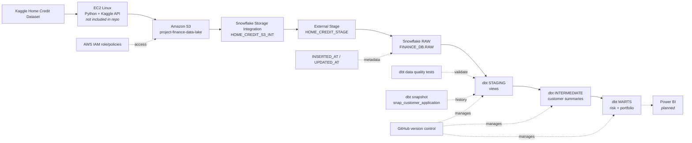
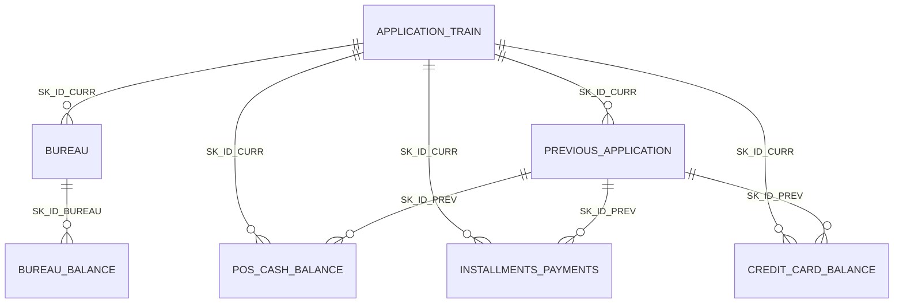
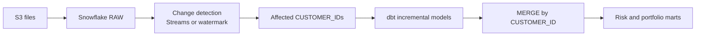

# Home Credit Risk Analytics

## End-to-End Cloud Data Engineering and Analytics Platform using AWS, Snowflake, dbt and SQL

[](https://www.getdbt.com/)
[](https://www.snowflake.com/)
[](https://aws.amazon.com/)
[](https://en.wikipedia.org/wiki/SQL)
[](https://github.com/hanith1362/home-credit-risk-analytics)

This project transforms the seven Home Credit Default Risk datasets into a Snowflake RAW layer and applies layered ELT transformations with dbt. The current models create customer-level credit profiles and analytical marts for credit risk and loan portfolio analysis.

The design addresses questions such as:

- Which customers show higher external credit exposure or delinquency?
- How have previous applications performed?
- What repayment behavior is visible in installment, POS/cash, and credit-card history?
- How much debt and credit utilization is associated with each customer?
- How can historical changes in application attributes be retained?

> **Implementation status:** Snowflake loading SQL, dbt models, macros, tests, and one snapshot are present in this repository. EC2/Python/Kaggle download code, automated orchestration, CDC services, and Power BI dashboards are not present and remain planned or operational prerequisites.

## Contents

- [Implementation status](#implementation-status)
- [Technology stack](#technology-stack)
- [Architecture](#architecture)
- [Source datasets](#source-datasets)
- [AWS ingestion design](#aws-ingestion-design)
- [Snowflake warehouse](#snowflake-warehouse)
- [dbt project](#dbt-project)
- [Staging models](#staging-models)
- [Intermediate models](#intermediate-models)
- [Macros and metric audit](#macros-and-metric-audit)
- [Snapshots and historical tracking](#snapshots-and-historical-tracking)
- [Data marts](#data-marts)
- [Incremental processing and CDC](#incremental-processing-and-cdc)
- [Data quality](#data-quality)
- [Metadata and auditing](#metadata-and-auditing)
- [How to run](#how-to-run)
- [Engineering decisions and challenges](#engineering-decisions-and-challenges)
- [Git workflow](#git-workflow)
- [Future roadmap](#future-roadmap)
- [Interview explanation](#interview-explanation)
- [Repository review notes](#repository-review-notes)

## Implementation status

| Area | Status | Evidence |
|---|---|---|
| Snowflake S3 integration, stage, file format, schema inference and loads | **Configured in SQL** | [`Home_credit.sql`](Home_credit.sql) |
| Snowflake RAW source definitions | **Configured** | [`_home_credit__sources.yml`](home_credit_analytics/models/staging/home_credit/_home_credit__sources.yml) |
| Seven staging models | **Implemented** | `models/staging/home_credit/` |
| Six customer-level intermediate summaries | **Implemented** | `models/intermediate/` |
| Customer credit risk mart | **Implemented as incremental/merge** | [`mart_customer_credit_risk.sql`](home_credit_analytics/models/marts/mart_customer_credit_risk.sql) |
| Loan portfolio mart | **Implemented as table** | [`mart_loan_portfolio.sql`](home_credit_analytics/models/marts/mart_loan_portfolio.sql) |
| dbt source/model tests | **Partially implemented** | Staging YAML files |
| SCD Type 2 application snapshot | **Implemented** | [`snap_customer_application.sql`](home_credit_analytics/snapshots/snap_customer_application.sql) |
| Python/Kaggle/EC2 ingestion code | **Not in repository** | No Python ingestion files are tracked |
| Snowflake Streams, Tasks, Snowpipe and automated CDC | **Planned** | No corresponding SQL is present |
| Power BI dashboards | **Planned** | No report or dashboard files are present |

## Technology stack

| Technology | Purpose in this project | Why it fits |
|---|---|---|
| Python | Intended ingestion and file-management runtime | Well suited to API calls, archive handling and automation |
| Kaggle API | Intended download mechanism for the Home Credit files | Repeatable, scriptable access to the source dataset |
| AWS EC2 | Documented target Linux environment for ingestion | Provides a controllable execution environment |
| Amazon S3 | Landing and durable raw-file storage | Separates immutable source files from warehouse transformations |
| AWS IAM | Role-based access between AWS and Snowflake | Avoids embedding long-lived cloud credentials in SQL |
| Snowflake | Cloud warehouse for RAW, dbt staging, intermediate and mart data | Scalable SQL analytics and native S3 integration |
| Snowflake Storage Integration | Trusted access from Snowflake to S3 | Uses an IAM role rather than inline keys |
| Snowflake External Stage | Named S3 location for loading files | Centralizes the landing location and file format |
| Snowflake `COPY INTO` | Loads CSV files into RAW tables | Native, auditable bulk ingestion |
| Snowflake `INFER_SCHEMA` | Derives table definitions from CSV headers and values | Reduces manual column-definition work for wide datasets |
| dbt Core | SQL model dependency management, testing and documentation | Makes transformations modular, reviewable and reproducible |
| dbt-Snowflake | Adapter used to compile and execute dbt on Snowflake | Provides Snowflake-specific materializations and SQL support |
| SQL | Ingestion checks and analytical transformations | Expresses aggregations and business rules close to the data |
| Jinja macros | Reusable metric formulas | Keeps repeated calculations consistent and parameterized |
| Git | Local version history and branching | Supports safe, reviewable changes |
| GitHub | Collaboration, code hosting and pull requests | Provides a recruiter-visible engineering workflow |
| Power BI | **Planned** consumption layer | Intended for future stakeholder dashboards; no report is committed |

## Architecture

### Current and configured flow



### Planned operational extensions

The following are not represented as completed components: Snowflake Streams, Snowflake Tasks, Snowpipe, automated CDC, changed-customer detection, fully optimized incremental processing, additional marts, and Power BI dashboards.

## Source datasets

The project is designed around the seven Home Credit Default Risk CSV files:

| Dataset | Warehouse table | Description |
|---|---|---|
| `application_train.csv` | `RAW.APPLICATION_TRAIN` | Customer application and default information |
| `bureau.csv` | `RAW.BUREAU` | External credit bureau history |
| `bureau_balance.csv` | `RAW.BUREAU_BALANCE` | Monthly external credit status |
| `previous_application.csv` | `RAW.PREVIOUS_APPLICATION` | Previous loan applications |
| `POS_CASH_balance.csv` | `RAW.POS_CASH_BALANCE` | Monthly POS and cash loan information |
| `installments_payments.csv` | `RAW.INSTALLMENTS_PAYMENTS` | Historical installment payment records |
| `credit_card_balance.csv` | `RAW.CREDIT_CARD_BALANCE` | Monthly credit-card balances and transactions |

### Important identifiers

| Identifier | Meaning |
|---|---|
| `SK_ID_CURR` | Customer/application identifier, renamed to `CUSTOMER_ID` in most staging models |
| `SK_ID_PREV` | Previous application identifier, renamed to `PREVIOUS_APPLICATION_ID` |
| `SK_ID_BUREAU` | External bureau record identifier, renamed to `BUREAU_CREDIT_ID` |
| `TARGET` | Default indicator, renamed to `DEFAULT_FLAG`; tested as `0` or `1` |

`bureau_balance.csv` does not contain `SK_ID_CURR`. It connects to a customer through `SK_ID_BUREAU`: `BUREAU_BALANCE.SK_ID_BUREAU -> BUREAU.SK_ID_BUREAU -> BUREAU.SK_ID_CURR`.



## AWS ingestion design

The Snowflake SQL documents this landing contract:

- Linux execution environment: EC2
- Source access: Python and the Kaggle API
- S3 bucket: `project-finance-data-lake`
- AWS region: `us-east-2`
- Landing prefix: `landing/home_credit/`
- Snowflake integration: `HOME_CREDIT_S3_INT`
- Access model: IAM role-based permissions

The repository does **not** contain the Python downloader, EC2 bootstrap script, or an archive/logging implementation. Archive and log prefixes are therefore not claimed as implemented. A production ingestion job would download and extract the seven CSVs, preserve the original files in S3, and write operational logs separately. Preserving raw files supports replay, auditability, backfills and independent reprocessing when a dbt rule changes.

## Snowflake warehouse

The configured warehouse objects are:

| Object | Value |
|---|---|
| Database | `FINANCE_DB` |
| RAW schema | `RAW` |
| Storage integration | `HOME_CREDIT_S3_INT` |
| External stage | `FINANCE_DB.RAW.HOME_CREDIT_STAGE` |
| File format | `FINANCE_DB.RAW.HOME_CREDIT_CSV_FORMAT` |

The file format is CSV with a header, comma delimiter, optionally quoted fields, `NULL`/`null` null markers, empty fields as null, trimmed spaces, and `ERROR_ON_COLUMN_COUNT_MISMATCH = FALSE`.

The loading journey in [`Home_credit.sql`](Home_credit.sql) is:

1. Create an S3 storage integration and validate its access.
2. Create `FINANCE_DB` and the `RAW` schema.
3. Create the CSV file format and external stage.
4. Inspect the stage with `LIST` and infer a CSV schema with `INFER_SCHEMA`.
5. Create each RAW table with `CREATE TABLE ... USING TEMPLATE`.
6. Load each named file using `COPY INTO ... MATCH_BY_COLUMN_NAME = CASE_INSENSITIVE`.
7. Run row-count and source-quality checks.

Representative, credential-safe examples:

```sql
CREATE OR REPLACE STAGE FINANCE_DB.RAW.HOME_CREDIT_STAGE
  URL = 's3://project-finance-data-lake/landing/home_credit/'
  STORAGE_INTEGRATION = HOME_CREDIT_S3_INT
  FILE_FORMAT = FINANCE_DB.RAW.HOME_CREDIT_CSV_FORMAT;
```

```sql
CREATE OR REPLACE TABLE FINANCE_DB.RAW.APPLICATION_TRAIN
USING TEMPLATE (
  SELECT ARRAY_AGG(OBJECT_CONSTRUCT(*))
    WITHIN GROUP (ORDER BY ORDER_ID)
  FROM TABLE(INFER_SCHEMA(
    LOCATION => '@FINANCE_DB.RAW.HOME_CREDIT_STAGE',
    FILE_FORMAT => 'FINANCE_DB.RAW.HOME_CREDIT_CSV_FORMAT',
    FILES => ('application_train.csv')
  ))
);
```

```sql
COPY INTO FINANCE_DB.RAW.APPLICATION_TRAIN
FROM @FINANCE_DB.RAW.HOME_CREDIT_STAGE
FILES = ('application_train.csv')
FILE_FORMAT = (FORMAT_NAME = 'FINANCE_DB.RAW.HOME_CREDIT_CSV_FORMAT')
MATCH_BY_COLUMN_NAME = CASE_INSENSITIVE
ON_ERROR = ABORT_STATEMENT;
```

The committed SQL should be treated as an environment setup script: replace account-specific IAM and Snowflake settings with deployment-specific values, and never commit passwords, tokens or private keys.

## dbt project

```text
home_credit_analytics/
├── dbt_project.yml
├── macros/
│   ├── credit_utilization.sql
│   ├── debt_to_income_ratio.sql
│   └── loan_rejection_rate.sql
├── models/
│   ├── example/schema.yml
│   ├── staging/home_credit/
│   │   ├── _home_credit__sources.yml
│   │   ├── stg_*.sql
│   │   └── stg_*.yml
│   ├── intermediate/
│   │   └── int_*.sql
│   └── marts/
│       ├── mart_customer_credit_risk.sql
│       └── mart_loan_portfolio.sql
├── snapshots/
│   └── snap_customer_application.sql
├── analyses/
├── seeds/
└── tests/
```

`dbt_project.yml` defines the project name `home_credit_analytics`, profile `home_credit_analytics`, and the standard model, macro, snapshot, seed, test and analysis paths. The configured materializations are:

| Folder | Schema | Default materialization |
|---|---|---|
| `models/staging/` | `staging` | view |
| `models/intermediate/` | `INTERMEDIATE` | view |
| `models/marts/` | `MARTS` | table |

Individual model configuration overrides the mart default where needed.

- `source()` references declared RAW tables, for example `source('home_credit_raw', 'BUREAU')`.
- `ref()` creates dependency-aware references between dbt models.
- Jinja renders macros and configuration before SQL is sent to Snowflake.
- Views keep staging and intermediate logic lightweight and recomputable.
- Tables and incremental tables provide stable consumption layers.
- Schema YAML files attach descriptions and column-level data tests.

## Staging models

All seven staging models use `source('home_credit_raw', ...)`, retain `INSERTED_AT` and `UPDATED_AT`, and standardize source names. The source grain is preserved rather than aggregated.

| Model | Source | Grain and purpose | Notable aliases |
|---|---|---|---|
| [`stg_application_train`](home_credit_analytics/models/staging/home_credit/stg_application_train.sql) | `APPLICATION_TRAIN` | One customer application row | `SK_ID_CURR -> CUSTOMER_ID`, `TARGET -> DEFAULT_FLAG`, `AMT_CREDIT -> CREDIT_AMOUNT`, `AMT_INCOME_TOTAL -> ANNUAL_INCOME`, `DAYS_BIRTH -> AGE` calculation |
| [`stg_bureau`](home_credit_analytics/models/staging/home_credit/stg_bureau.sql) | `BUREAU` | One external bureau credit record | `SK_ID_BUREAU -> BUREAU_CREDIT_ID`, `CREDIT_ACTIVE -> CREDIT_STATUS`, credit/debt/overdue aliases |
| [`stg_bureau_balance`](home_credit_analytics/models/staging/home_credit/stg_bureau_balance.sql) | `BUREAU_BALANCE` | One monthly status row per bureau credit | `SK_ID_BUREAU -> BUREAU_CREDIT_ID`, `MONTHS_BALANCE -> MONTH_OFFSET`, `STATUS -> MONTHLY_CREDIT_STATUS` |
| [`stg_previous_application`](home_credit_analytics/models/staging/home_credit/stg_previous_application.sql) | `PREVIOUS_APPLICATION` | One previous application | `SK_ID_PREV -> PREVIOUS_APPLICATION_ID`, application, contract, rejection and payment aliases |
| [`stg_pos_cash_balance`](home_credit_analytics/models/staging/home_credit/stg_pos_cash_balance.sql) | `POS_CASH_BALANCE` | One monthly POS/cash balance row | `SK_ID_PREV -> PREVIOUS_APPLICATION_ID`, installment and delinquency aliases |
| [`stg_installments_payments`](home_credit_analytics/models/staging/home_credit/stg_installments_payments.sql) | `INSTALLMENTS_PAYMENTS` | One installment payment record | scheduled/actual day and amount aliases |
| [`stg_credit_card_balance`](home_credit_analytics/models/staging/home_credit/stg_credit_card_balance.sql) | `CREDIT_CARD_BALANCE` | One monthly credit-card record | balance, limit, drawing, payment, receivable and delinquency aliases |

Examples of implemented transformations:

```sql
-- stg_application_train
SK_ID_CURR AS CUSTOMER_ID,
TARGET AS DEFAULT_FLAG,
ROUND(ABS(DAYS_BIRTH) / 365.25, 1) AS AGE
```

```sql
-- stg_installments_payments
AMT_INSTALMENT AS SCHEDULED_PAYMENT_AMOUNT,
AMT_PAYMENT AS ACTUAL_PAYMENT_AMOUNT
```

The staging YAML tests `CUSTOMER_ID` uniqueness and non-nullness in the application model, `DEFAULT_FLAG` values of `0` or `1`, non-null identifiers, and accepted bureau-balance statuses. Several other columns are documented but not tested.

## Intermediate models

Every intermediate model is a view and groups its source history to `CUSTOMER_ID`, except that the bureau-balance monthly history is not currently summarized into a separate intermediate model.

| Model | Inputs | Transformations and business meaning | Output grain |
|---|---|---|---|
| [`int_bureau_customer_summary`](home_credit_analytics/models/intermediate/int_bureau_customer_summary.sql) | `stg_bureau` | `COUNT(DISTINCT)`, `COUNT_IF`, `SUM(COALESCE(...))`, `MAX`, and ingestion bounds summarize accounts, active/closed status, exposure, debt and overdue amounts | One row per `CUSTOMER_ID` |
| [`int_previous_application_summary`](home_credit_analytics/models/intermediate/int_previous_application_summary.sql) | `stg_previous_application` | Counts applications, approved/refused outcomes, requested/approved amounts, average annuity and payment count | One row per `CUSTOMER_ID` |
| [`int_installment_payment_summary`](home_credit_analytics/models/intermediate/int_installment_payment_summary.sql) | `stg_installments_payments` | Derives `PAYMENT_DELAY_DAYS` and non-negative `UNPAID_AMOUNT`; counts late/on-time records and aggregates payment amounts | One row per `CUSTOMER_ID` |
| [`int_pos_cash_summary`](home_credit_analytics/models/intermediate/int_pos_cash_summary.sql) | `stg_pos_cash_balance` | Counts loans, sums total/remaining installments, counts overdue records, checks tolerance delinquency and contract status | One row per `CUSTOMER_ID` |
| [`int_credit_card_summary`](home_credit_analytics/models/intermediate/int_credit_card_summary.sql) | `stg_credit_card_balance` | Aggregates balances, limits, utilization, drawings, payments, receivables, transaction counts and delinquency | One row per `CUSTOMER_ID` |
| [`int_customer_credit_profile`](home_credit_analytics/models/intermediate/int_customer_credit_profile.sql) | Application staging plus all five customer summaries | Uses `LEFT JOIN` and `COALESCE` to retain every application customer while defaulting absent history metrics to zero | One row per application `CUSTOMER_ID` |

The profile starts from `stg_application_train` because it is the customer population of interest. `LEFT JOIN` prevents a customer from disappearing simply because that customer has no bureau, previous-application, installment, POS/cash or credit-card history. The upstream summaries are already grouped by `CUSTOMER_ID`, which prevents the profile join from multiplying rows across independent event grains.

## Macros and metric audit

A dbt macro is reusable Jinja SQL. These macros parameterize column expressions so the same calculation can be called from multiple models:

| Macro | Formula in repository | Used by |
|---|---|---|
| [`credit_utilization`](home_credit_analytics/macros/credit_utilization.sql) | `ROUND((balance / NULLIF(limit, 0)) * 100, 2)` | `int_credit_card_summary`, `mart_loan_portfolio` |
| [`debt_to_income_ratio`](home_credit_analytics/macros/debt_to_income_ratio.sql) | `ROUND(debt / NULLIF(income, 0), 4)` | `mart_customer_credit_risk` |
| [`loan_rejection_rate`](home_credit_analytics/macros/loan_rejection_rate.sql) | `COALESCE(ROUND(refused * 100.0 / NULLIF(total, 0), 2), 0)` | Both marts |

Example:

```sql
{{ debt_to_income_ratio(
    'TOTAL_BUREAU_OUTSTANDING_DEBT',
    'ANNUAL_INCOME'
) }} AS DEBT_TO_INCOME_RATIO
```

The macro audit found an implementation issue that is intentionally not hidden by this README:

- `mart_loan_portfolio.sql` calls `credit_utilization('TOTAL_APPROVED_CREDIT', 'Approved_applications')`.
- `Approved_applications` is a count of approved applications, not a credit limit, and the selected intermediate profile column is `APPROVED_APPLICATIONS` (uppercase-insensitive in Snowflake, but still semantically a count).
- The resulting `AVG_APPROVED_CREDIT` calculation is therefore not a conventional credit-utilization metric and should be reviewed before production use.

The README documents this issue rather than silently changing the SQL.

## Snapshots and historical tracking

[`snap_customer_application.sql`](home_credit_analytics/snapshots/snap_customer_application.sql) is a dbt snapshot with:

- `target_schema='SNAPSHOTS'`
- `unique_key='CUSTOMER_ID'`
- `strategy='check'`
- `check_cols`: `ANNUAL_INCOME`, `CREDIT_AMOUNT`, `ANNUITY_AMOUNT`, `GOODS_PRICE`

The check strategy compares those columns between snapshot runs. When a tracked value changes, dbt closes the prior version and inserts a new version with metadata columns including `DBT_VALID_FROM`, `DBT_VALID_TO`, and `DBT_SCD_ID`.

For example, if `ANNUAL_INCOME` changes for one `CUSTOMER_ID`, the prior row remains queryable with a populated `DBT_VALID_TO`, and a new row starts at the next `DBT_VALID_FROM`. This supports point-in-time analysis without overwriting the prior application state.

A snapshot preserves row history based on change detection. An incremental model is a build strategy: it processes new or selected rows and merges them into a target. An incremental model does not automatically provide historical versions.

## Data marts

### `mart_customer_credit_risk`

[`mart_customer_credit_risk.sql`](home_credit_analytics/models/marts/mart_customer_credit_risk.sql) is the customer-facing risk mart. It reads `int_customer_credit_profile`, has one row per `CUSTOMER_ID`, and is configured as:

```sql
{{ config(
    materialized='incremental',
    unique_key='CUSTOMER_ID',
    incremental_strategy='merge'
) }}
```

It exposes default status, age, income and current credit context; bureau exposure and debt; previous application outcomes; installment payment behavior; POS delinquency; credit-card balances and utilization; and derived `DEBT_TO_INCOME_RATIO` and `LOAN_REJECTION_RATE`.

Example questions include: Which customers have high outstanding bureau debt relative to annual income? Which customers have repeated late payments or overdue POS records? How does default history compare with previous application refusal rates?

### `mart_loan_portfolio`

[`mart_loan_portfolio.sql`](home_credit_analytics/models/marts/mart_loan_portfolio.sql) is a table with one row per `CUSTOMER_ID`. It summarizes previous application volume and amounts, calculates `APPROVAL_RATE` and `REFUSAL_RATE`, and includes customer income, current credit, annuity and age.

The model currently uses `materialized='table'`, not incremental materialization. Its `AVG_APPROVED_CREDIT` expression is documented in the [macro audit](#macros-and-metric-audit) because it passes approved credit and approved-application count to a utilization macro.

Additional marts such as repayment behavior and credit-card analytics are not present; they belong in the roadmap.

## Incremental processing and CDC

The current incremental design is limited to `mart_customer_credit_risk`:

- On a full refresh, dbt rebuilds the target.
- On a normal incremental run, the Snowflake adapter uses `MERGE`.
- `CUSTOMER_ID` is the `unique_key` used to match source and target rows.
- `is_incremental()` is not present in the model.
- There is no source watermark or changed-customer filter.

Consequently, `unique_key='CUSTOMER_ID'` defines how dbt matches records; it does **not** identify which customers changed. Without an `is_incremental()` predicate, the model selects the full customer profile each run and relies on the merge operation to reconcile rows. This is functionally different from efficient changed-customer processing.

CDC means identifying inserts, updates and deletes from source changes. Snowflake Streams can record table changes, Tasks can schedule SQL or dbt orchestration, and Snowpipe can automate file arrival ingestion. None of those services is configured in this repository.

The intended future flow is:



For bureau changes, the affected customer must be derived through `BUREAU_BALANCE.SK_ID_BUREAU -> BUREAU.SK_ID_BUREAU -> BUREAU.SK_ID_CURR`.

## Data quality

Tests are declared in staging YAML files using dbt's built-in `unique`, `not_null`, and `accepted_values` tests.

Representative implemented examples:

```yaml
- name: CUSTOMER_ID
  data_tests:
    - not_null
    - unique

- name: DEFAULT_FLAG
  data_tests:
    - not_null
    - accepted_values:
        arguments:
          values: [0, 1]
```

```yaml
- name: MONTHLY_CREDIT_STATUS
  data_tests:
    - not_null
    - accepted_values:
        arguments:
          values: ['0', '1', '2', '3', '4', '5', 'C', 'X']
```

These tests prevent missing keys, duplicate application customers and invalid domain values. The repository does not currently declare relationship tests between staging identifiers, mart-level uniqueness tests, or broader financial range tests. Useful future additions include:

- `relationships` from `BUREAU_BALANCE.BUREAU_CREDIT_ID` to `stg_bureau.BUREAU_CREDIT_ID`
- relationship tests from previous-history models to application customers
- uniqueness tests on mart `CUSTOMER_ID`
- accepted values for contract status fields
- non-negative and denominator-aware metric tests

The starter [`models/example/schema.yml`](home_credit_analytics/models/example/schema.yml) still contains example model tests, but the corresponding example SQL models are not present.

## Metadata and auditing

The staging models carry `INSERTED_AT` and `UPDATED_AT` from RAW. Intermediate summaries preserve or aggregate these as fields such as `FIRST_INGESTED_AT`, `LAST_UPDATED_AT`, `LATEST_INSERTED_AT`, and `LATEST_UPDATED_AT`.

These fields help answer when a record entered the pipeline and when the warehouse representation was last updated. They are useful for operational audit, freshness checks, replay analysis and future watermarks. They do not automatically prove that a source business attribute changed: an ingestion timestamp is not the same as a source-system `updated_at`, and no CDC logic currently consumes these columns.

## How to run

### Prerequisites

- Python 3.x
- dbt Core
- `dbt-snowflake`
- A Snowflake account with access to the configured database and warehouse
- S3/IAM permissions if loading the source files
- The seven source CSVs in the configured S3 landing prefix

The repository does not include an automated AWS ingestion script. The Snowflake setup SQL assumes the files have already been placed in S3.

### Install dbt

```bash
python -m venv .venv
source .venv/bin/activate        # Windows: .venv\Scripts\activate
python -m pip install --upgrade pip
python -m pip install dbt-snowflake
```

### Configure the Snowflake profile

Run dbt from the project directory:

```bash
cd home_credit_analytics
```

Create `~/.dbt/profiles.yml` outside the repository. Do not commit it; this repository's `.gitignore` already excludes `profiles.yml`, `.env` files and dbt artifacts.

```yaml
home_credit_analytics:
  target: dev
  outputs:
    dev:
      type: snowflake
      account: "<account>"
      user: "<user>"
      password: "<password>"
      role: "<role>"
      database: FINANCE_DB
      warehouse: "<warehouse>"
      schema: DBT_DEV
      threads: 4
```

Prefer environment variables, external secret managers or key-pair authentication over hard-coded credentials.

### Validate and build

```bash
dbt debug
dbt parse
dbt compile
dbt run
dbt test
dbt build
dbt snapshot
```

`dbt build` is the normal integrated validation command because it runs selected models and associated tests according to the project graph. Run `dbt snapshot` after the source staging relation is available and whenever application history should be checked.

## Engineering decisions and challenges

| Challenge | Current design | Remaining consideration |
|---|---|---|
| Multiple source grains | Staging preserves source grain; intermediate models aggregate by customer | Add explicit grain tests and relationship tests |
| `bureau_balance` lacks customer ID | Resolve through the bureau record key | Add a dedicated customer-level bureau-balance summary if needed |
| Row multiplication in joins | Summarize each history source before joining the customer profile | Validate one-row-per-customer invariants at every boundary |
| Missing history | `LEFT JOIN` plus `COALESCE` keeps the application population complete | Distinguish “no history” from “unknown” where the business requires it |
| NULL amounts and denominators | `COALESCE` and `NULLIF` are used in many calculations | Add metric-specific tests and agreed null semantics |
| Credit utilization above 100% | The macro reports the raw percentage and does not cap it | Decide whether over-limit utilization should remain visible or be capped |
| Historical tracking without source `updated_at` | A check-based dbt snapshot tracks selected application attributes | Add a reliable source change timestamp if one becomes available |
| Incremental processing | `MERGE` is configured by `CUSTOMER_ID` | Add changed-customer filtering, watermarks or Streams before claiming efficient CDC |
| Late-arriving records | Raw preservation supports replay and reprocessing | Define a backfill policy and affected-customer recomputation strategy |

## Git workflow

The intended development workflow is:

```text
Create branch -> modify SQL/YAML -> stage -> commit -> push
-> open pull request -> review -> merge
```

Useful commands:

```bash
git switch -c feature/document-model
git status
git diff
git add README.md
git commit -m "Document Home Credit analytics platform"
git push -u origin feature/document-model
```

Keep credentials, generated `target/` files, dbt packages, logs and local profiles out of commits.

## Future roadmap

1. Implement Snowflake Streams for source change capture.
2. Implement Snowflake Tasks or an external scheduler for orchestration.
3. Configure Snowpipe for automatic file-arrival ingestion.
4. Build affected-customer detection, including the bureau-to-customer path.
5. Complete efficient incremental processing with watermarks and `is_incremental()`.
6. Add `mart_repayment_behavior`.
7. Add `mart_credit_card_analytics`.
8. Add Power BI dashboards.
9. Expand relationships, uniqueness, freshness and mart-level tests.
10. Add automated dbt CI/CD through GitHub Actions.

## Interview explanation

### 60-second explanation

> I built a cloud data warehouse and dbt transformation project for Home Credit risk analytics. The design lands seven related Kaggle datasets in S3, loads them into Snowflake RAW tables using an external stage, and standardizes them with dbt staging views. Intermediate models aggregate bureau, previous applications, installment payments, POS/cash history and credit-card history to one row per customer. The project then exposes a customer credit risk mart and a loan portfolio mart, adds reusable Jinja metrics, and uses a dbt check snapshot to preserve selected application changes. The next production steps are CDC, orchestration, stronger relationship tests and BI dashboards.

### 2-minute technical explanation

> The source data has several grains: customers, previous applications, bureau accounts, monthly bureau balances, installments and monthly account histories. I preserve those grains in staging and aggregate each history independently by `CUSTOMER_ID` before joining them to the application population. That avoids multiplying rows when one customer has many records in several child datasets. The customer profile uses left joins and zero-filling so customers without a particular history remain in the analytical population.
>
> Snowflake receives files from an S3 external stage. `INFER_SCHEMA` and `CREATE TABLE ... USING TEMPLATE` establish RAW tables, and `COPY INTO` loads the named CSV files. dbt then manages dependencies with `source()` and `ref()`. Staging and intermediate layers are views, while the marts are a table and an incremental merge model. The incremental model's `unique_key` controls matching but is not itself CDC, so changed-customer detection is still a roadmap item. The snapshot uses a check strategy on selected application attributes to retain SCD Type 2 history.

### Ten interview questions and answers

1. **Why separate staging, intermediate and marts?**  
   Staging standardizes source names, intermediate models apply reusable business aggregations, and marts present stable business-facing outputs.
2. **Why aggregate before joining customer histories?**  
   Independent one-to-many joins can multiply rows. Customer-level summaries make each join one-to-one at the profile layer.
3. **How does `bureau_balance` reach a customer?**  
   It joins to `BUREAU` by `SK_ID_BUREAU`; the bureau record supplies `SK_ID_CURR`.
4. **What does `unique_key='CUSTOMER_ID'` do?**  
   It tells dbt how to match source and target rows during the configured merge. It does not discover changed customers.
5. **How would you make the incremental model efficient?**  
   Add a trustworthy watermark or Stream, derive affected customer IDs, filter the profile with `is_incremental()`, and merge only those customers.
6. **Why use a snapshot?**  
   A snapshot preserves prior versions of selected attributes, enabling point-in-time history instead of overwriting changes.
7. **What does `NULLIF` protect against?**  
   It prevents division-by-zero errors in ratios such as debt-to-income and rejection rate.
8. **What does `COALESCE` do in the customer profile?**  
   It converts absent child-history aggregates to zero so a missing history does not remove or nullify the customer profile.
9. **What tests are currently present?**  
   The YAML declares `not_null`, `unique` and `accepted_values` tests, especially for customer IDs, default flags and bureau statuses.
10. **What would you improve before production?**  
    Add CDC and orchestration, validate the portfolio credit-utilization expression, add relationship and mart uniqueness tests, and build a governed BI layer.

## Repository review notes

### Files inspected

- `Home_credit.sql`
- `home_credit_analytics/dbt_project.yml`
- `home_credit_analytics/.gitignore`
- `home_credit_analytics/README.md`
- `home_credit_analytics/models/staging/home_credit/_home_credit__sources.yml`
- All seven staging SQL files and all seven staging YAML files
- All six intermediate SQL models
- Both mart SQL models
- All three macro SQL files
- `home_credit_analytics/snapshots/snap_customer_application.sql`
- `home_credit_analytics/models/example/schema.yml`
- `.git` history and the tracked-file list
- `logs/dbt.log` for available execution context

### Technical issues and boundaries discovered

- The original nested README was the default dbt starter text; this root README replaces it as the repository-level entry point.
- No Python, Kaggle API, EC2 provisioning, S3 archive, Snowpipe, Stream, Task or Power BI implementation is tracked.
- The staging SQL aliases age as `AGE`, while `stg_application_train.yml` documents `AGE_YEARS`. This should be reconciled in the model contract.
- `mart_loan_portfolio` uses `credit_utilization` with `TOTAL_APPROVED_CREDIT` and `Approved_applications`, producing a semantically questionable `AVG_APPROVED_CREDIT` metric. The SQL was not changed.
- The committed dbt log contains environment-specific connection metadata, and the Snowflake setup SQL contains an environment-specific IAM role reference. These should be redacted or excluded before public distribution; no credentials or account identifiers are reproduced in this README.

This README is saved at the repository root as `README.md`. Existing SQL, YAML, Python and dbt configuration files were not modified.
